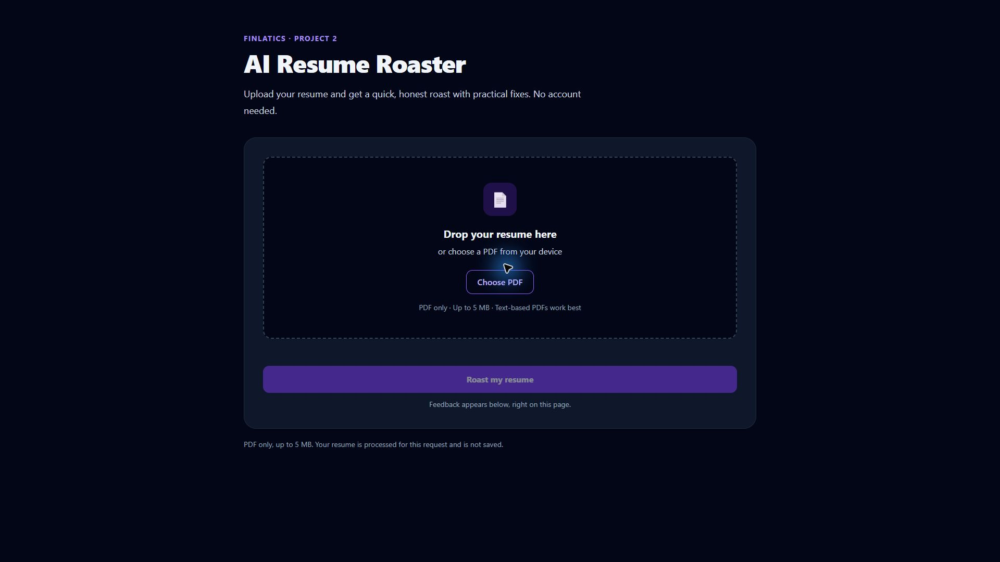
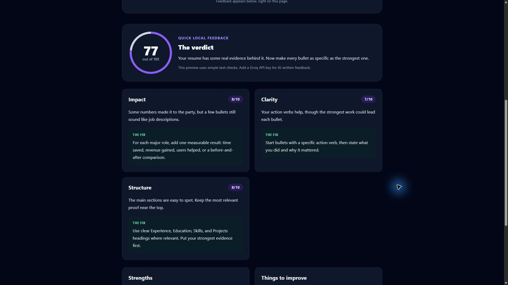

# AI Resume Roaster v1.0.0

First release of the simple, single-page resume feedback app.

- Drag and drop a text-based PDF (up to 5 MB).
- Get a score, section feedback, and practical fixes on the same page.
- Use local feedback immediately, or set `GROQ_API_KEY` for AI-written feedback.
- No account or database is required; resumes and results are not saved.
- PDF extraction is isolated per request so consecutive uploads work reliably.

## Previews

The feedback preview uses a synthetic resume.
